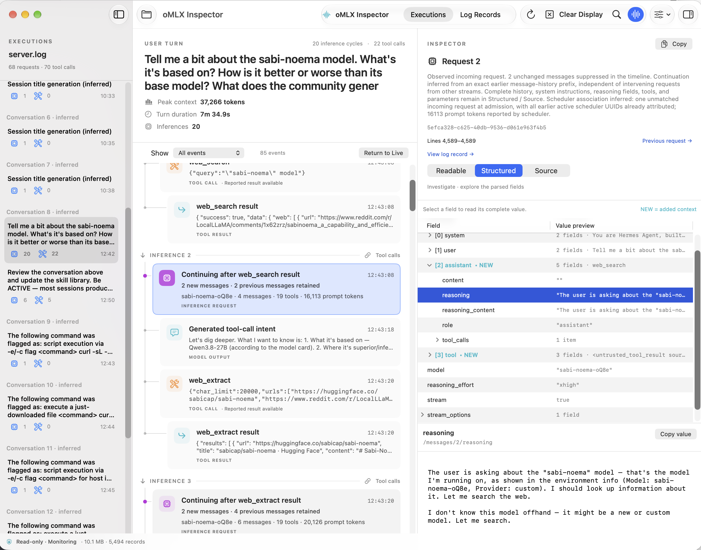

# oMLX Inspector

A native macOS utility for understanding local oMLX inference logs. Browse user turns, inference requests, model output, and reported tool calls and results, then inspect the original records behind them.

I wrote this utility (with more than a little help from Claude, Codex, and Qwen) because I wanted to make it easier to decompose, read, and follow log records throughout a turn, but not lose any details. 

Log output is read directly from the oMLX generated log file. Does not interfere with oMLX output. Can read logs as they're written or after the fact.

The application reads existing logs; it does not submit inference requests or modify oMLX, agent configuration, or source log data.

Version **0.3.0** provides both an execution timeline and a full log-record browser.

## Requirements

- Apple Silicon Mac running macOS 27 or later.
- Xcode with a Swift 6 compiler and a macOS 27 SDK, installed at `/Applications/Xcode.app` for the build script below.
- Python 3 for build-time source discovery.
- An existing oMLX log. Available detail depends on what was logged: request payloads, scheduler activity, and completion summaries supply different evidence. Missing records cannot be reconstructed.

No third-party packages or running database service are required.

## What it Looks Like

### Per-Execution Log Trace


### Per Log Record Trace



## Build and open

From the repository root:

```sh
./Tools/build.sh
open "build/oMLX Inspector.app"
```

The script compiles the native application, assembles its bundle, and applies and verifies a local ad-hoc signature. This is a local source build, not a notarized distribution. You can copy the resulting application to your Applications folder.

## First use

1. Press **⌘O** and choose an oMLX log. The file picker initially opens `~/.omlx/logs`.
2. In **Executions**, select a user turn, then an event in its timeline.
3. Use the Inspector's representations to examine that event:
   - **Readable** summarizes the request, changes in message history, and available execution metrics.
   - **Structured** lets you expand request JSON and copy complete field values.
   - **Source** displays the original log record, checked against its recorded byte range and digest.
4. Switch to **Log Records** to browse every framed record, including scheduler, cache, model-loading, and diagnostic messages that have no timeline event.

**View log record →** opens the source record behind a timeline event. **Return to executions →** restores the execution selection. Tool-call/result links follow explicit call IDs where available; **Previous request** opens an established comparison baseline.

## Search and live monitoring

- **⌘F** searches complete event content in Executions or complete source records in Log Records. Searches are literal and case-insensitive, with up to 200 matching results. Record searches respect level and logger filters.
- **Monitor Log** reads appended data while the app is open. It defaults on; monitoring and following the newest activity are separate controls.
- **Return to Live** (**⇧⌘L**) follows the newest indexed event. Selecting or browsing older activity pauses following while monitoring can continue.
- **Clear Display** (**⌘K**) hides indexed activity and follows new activity without deleting any log data. **Show History** restores the full view. The cleared boundary is temporary.
- **⌘R** rebuilds the source index. Following starts paused after relaunch.

Log replacement, truncation, and rotation are handled as separate source generations. While browsing history, the app offers to open the current log; while following live activity, it opens the new generation automatically. Deleted or overwritten evidence may no longer be available.

## Understanding the evidence

Turn headers show peak reported prompt context, observed inference count, and duration when a terminal completion can be associated. Incomplete timing is labeled **Observed span**; missing counts may produce **Peak observed context**. These metrics describe the whole turn, even when filters hide events.

Conversation reconstruction and some request-to-scheduler relationships are inferred. Completion summaries are associated only when the evidence is unambiguous and consistent. Overlapping requests or missing records can leave a finish reason or duration unavailable. The app preserves that uncertainty rather than guessing.

Repeated request history can be suppressed in the timeline, but Structured and Source retain the original content. Tool results are agent-reported evidence, not independent proof that a tool succeeded. A model finish reason of **Tool calls** does not establish successful tool execution.

## Privacy and limits

Processing stays on your Mac. The app has no network or telemetry component, privileged helper, or background launch agent. It rebuilds its in-memory index when opened and does not cache log contents to disk. Preferences include the last source and selection; copied content goes to the system clipboard. Logs and screenshots can contain sensitive prompts, tool arguments, and results.

- Index memory grows with the number of records, events, and conversation histories. There is no whole-file size limit, but a single record has a 64 MiB safety ceiling. An oversized record produces an error rather than being silently skipped.
- Long timelines and record lists use pages of 200 items. Full content remains available through the Inspector and copy controls.
- Search reads evidence on demand, so large logs can take time to search.
- Parsing depends on supported oMLX log syntax. Generated text that perfectly imitates a log header can make record boundaries ambiguous.
- Export, automatic anomaly detection, and comprehensive accessibility validation are not included.

## Development checks

Run the core regression suite from the repository root:

```sh
DEVELOPER_DIR=/Applications/Xcode.app/Contents/Developer swift test -c release
python3 Tools/test_source_files.py
```

The public suite uses synthetic fixtures and requires no private logs. The large-file test below is opt-in and skipped unless explicitly enabled.

The optional large-file test creates and deletes a disposable log of about 2 GiB; allow sufficient free disk space:

```sh
INSPECTOR_LARGE_LOG_BYTES=2147483648 \
  DEVELOPER_DIR=/Applications/Xcode.app/Contents/Developer swift test -c release
```
